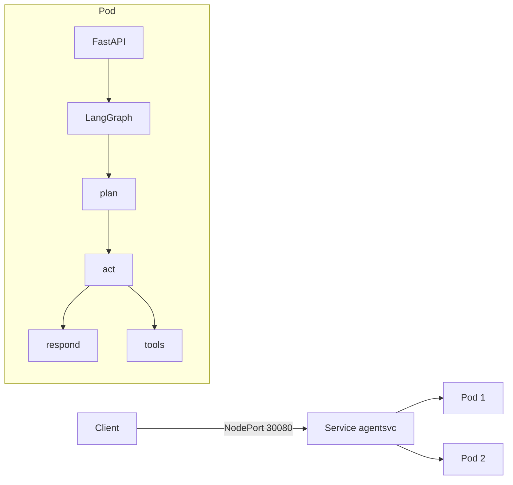

# langgraph-k8s-deploy

A LangGraph agent service in Python, containerised and deployed to a local
Kubernetes cluster by Terraform, with a GitHub Actions pipeline that lints,
tests, deploys, and smoke-tests it on every push.

The service runs with no API keys and no network calls, so the whole pipeline is
reproducible on a laptop and in CI. One `terraform apply` creates the kind
cluster, loads the image, and waits for a pod to pass its readiness probe.

## Measured results

Both numbers come from a real deployment on the machine described below. Each
row lists the command that produced it. No number here is estimated.

| Measurement | Value | Command |
|---|---|---|
| Cold deploy, `terraform apply` to first ready pod | **101 s** | `CONTAINER_ENGINE=podman bash scripts/measure-deploy.sh` |
| Request latency through the NodePort Service, p50 | **7.64 ms** | `python3 scripts/bench.py --requests 200 --warmup 20 --concurrency 1` |
| Same run, p95 / p99 | 12.40 ms / 21.10 ms | as above |
| Latency at concurrency 8, p50 | 45.44 ms | `python3 scripts/bench.py --requests 400 --warmup 40 --concurrency 8` |
| Same run, p95 / p99 | 142.35 ms / 188.07 ms | as above |

Full benchmark output, 200 requests, 0 errors:

```json
{"url":"http://localhost:30080/invoke","count":200,"concurrency":1,
 "p50_ms":7.64,"p95_ms":12.4,"p99_ms":21.1,"min_ms":4.79,"max_ms":85.66,
 "mean_ms":8.52,"errors":0}
```

### What the 101 seconds covers

The cold deploy timer starts at `terraform apply` and stops when Terraform
returns. The deployment sets `wait_for_rollout = true`, so apply only returns
after a pod passes its readiness probe. The span covers kind cluster creation,
the container image build, the image load into the node, and the rollout.

It does not cover downloading the kind node image or the Python base images.
Those were already in the local image cache. A first-ever run on a clean machine
takes longer, and how much longer depends on the network.

### Test environment

| Item | Value |
|---|---|
| Host | macOS 14.6, 8 CPU, 16 GB RAM |
| Container engine | podman 5.8.5 in a rootful VM, 4 CPU, 6 GB RAM |
| Cluster | kind 0.32.0, single control-plane node, Kubernetes v1.35.0 |
| Terraform | 1.15.8 |
| Replicas | 2 |
| Pod resources | requests 50m CPU / 128Mi, limits 500m CPU / 512Mi |

The p50 of 7.64 ms is the full round trip from the host, through the NodePort,
through kube-proxy, into the pod, through the agent graph, and back. The graph
runs a deterministic planner and a pure Python tool, so the number reflects
network and framework overhead rather than model inference.

## What this repository shows

- A LangGraph `StateGraph` with a conditional edge, wrapped in a FastAPI service.
- An MCP-style JSON-RPC 2.0 endpoint that lists and calls tools.
- Liveness and readiness probes that mean something. Readiness only passes after
  the graph compiles.
- Structured single-line JSON logs with a request ID and a duration per request.
- A multi-stage Dockerfile that runs as a non-root user, uid 10001.
- Terraform that owns the whole stack, from the cluster to the Service.
- A CI workflow that deploys to a real cluster and always tears it down.
- One script, `scripts/ci-local.sh`, that runs the identical steps on a laptop.

## Architecture



The `plan` node picks a tool from the question text using deterministic rules.
When it picks none, the graph skips `act` and goes straight to `respond`. Every
node appends a line to `steps`, so a caller can read the trace in the response.

## Quick start

Requirements: Docker or podman, kind, Terraform 1.6 or later, kubectl, uv.

```bash
# 1. Run the tests
uv sync --frozen
uv run pytest -q

# 2. Create the cluster and deploy
terraform -chdir=infra init
terraform -chdir=infra apply -auto-approve

# 3. Check it
bash scripts/smoke.sh
python3 scripts/bench.py --requests 100

# 4. Tear it down
terraform -chdir=infra destroy -auto-approve
```

Terraform builds and loads the image itself through `scripts/load-image.sh`, so
no registry and no credentials are involved.

On a host with podman instead of Docker, set the engine explicitly:

```bash
export CONTAINER_ENGINE=podman
export KIND_EXPERIMENTAL_PROVIDER=podman
```

## API

| Method | Path | Purpose |
|---|---|---|
| GET | `/healthz` | Liveness. Always 200 while the process runs. |
| GET | `/readyz` | Readiness. 200 after the graph compiles, else 503. |
| POST | `/invoke` | Run the agent graph. Returns the answer, the trace, and latency. |
| POST | `/mcp` | JSON-RPC 2.0. Supports `tools/list` and `tools/call`. |

```bash
curl -s localhost:30080/invoke \
  -H 'content-type: application/json' \
  -d '{"question":"convert 100 km to mi"}'

curl -s localhost:30080/mcp \
  -H 'content-type: application/json' \
  -d '{"jsonrpc":"2.0","id":1,"method":"tools/list"}'
```

The JSON-RPC endpoint returns `-32601` for an unknown method and `-32602` for
invalid params. The test suite covers both paths.

## Repository layout

| Path | Contents |
|---|---|
| `src/agentsvc/` | Graph, tools, FastAPI app, JSON logging |
| `tests/` | 15 pytest tests over tools, graph routing, and every endpoint |
| `Dockerfile` | Two stages, uv for the build, non-root runtime |
| `infra/` | Terraform: kind cluster, namespace, config map, deployment, Service |
| `scripts/load-image.sh` | Builds the image and loads it into the kind node |
| `scripts/smoke.sh` | Endpoint assertions against a running deployment |
| `scripts/bench.py` | Latency benchmark, standard library only |
| `scripts/measure-deploy.sh` | Times a cold deploy and prints JSON |
| `scripts/ci-local.sh` | Runs the CI steps locally |
| `.github/workflows/ci.yml` | Lint and test, then deploy and smoke-test on kind |

## Notes and limitations

- The agent uses a deterministic rule-based planner, not a language model. That
  keeps CI free, offline, and repeatable. Swapping in a real model means
  replacing the `plan` node and adding a key.
- The image reference is fully qualified as
  `docker.io/library/langgraph-agentsvc:dev` on purpose. podman prefixes
  unqualified tags with `localhost/`, while containerd expands them to
  `docker.io/library/`. The two must agree or `imagePullPolicy: IfNotPresent`
  never finds the preloaded image.
- Terraform holds cluster credentials in local state. This is fine for a
  throwaway local cluster and wrong for anything shared.
- One node and one namespace. No ingress, no TLS, no autoscaling, no registry.

## Licence

MIT. See `LICENSE`.
